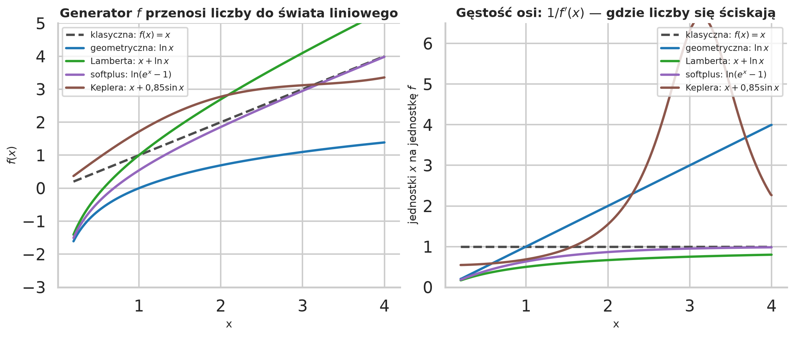
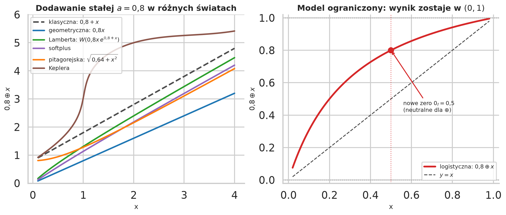
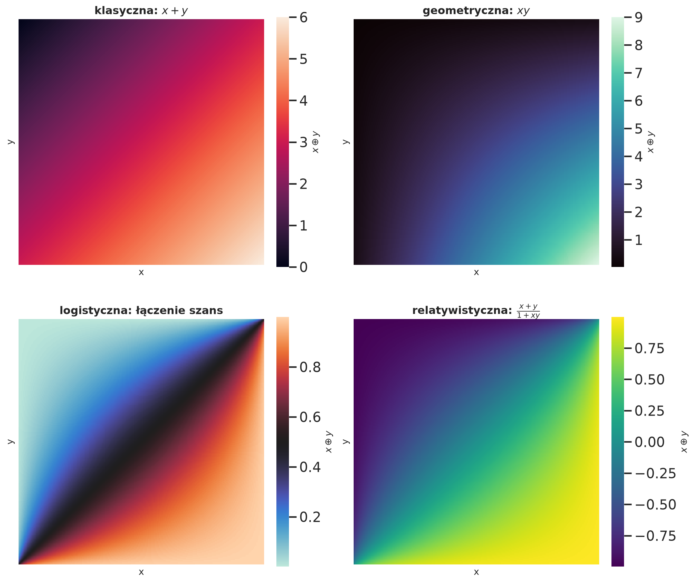
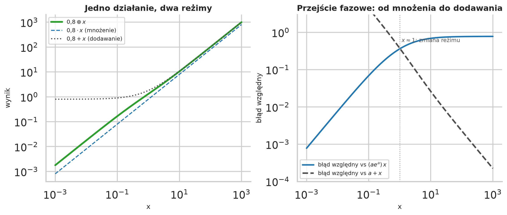
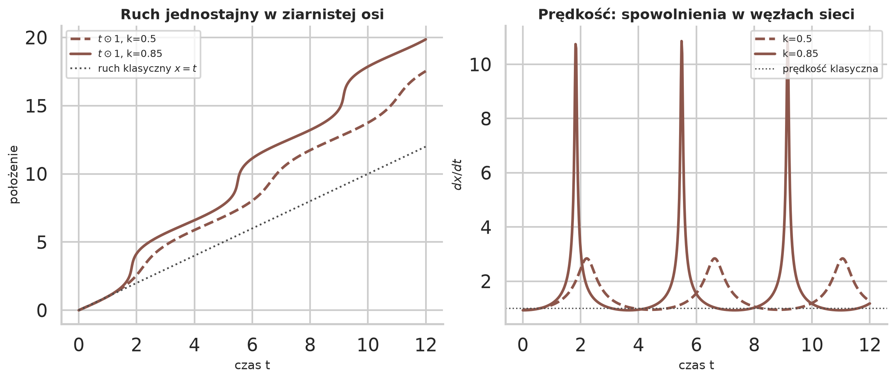
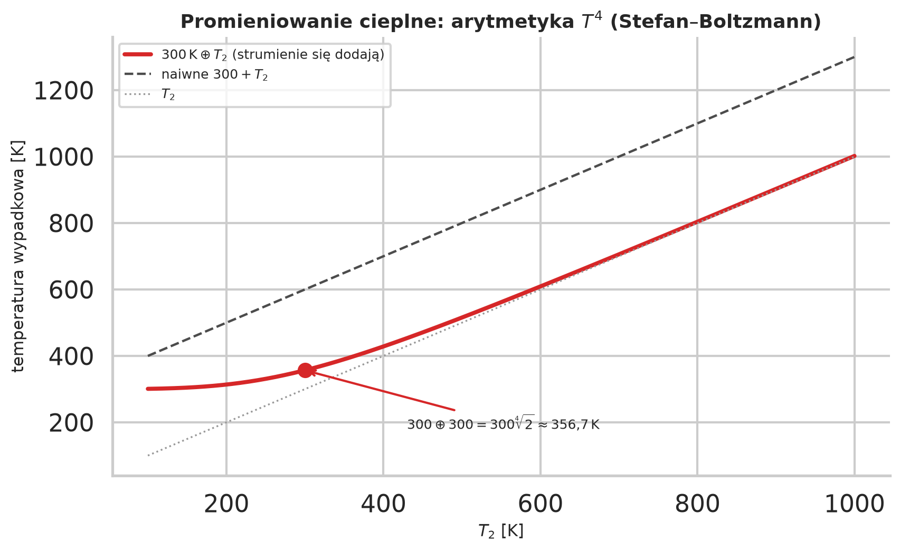
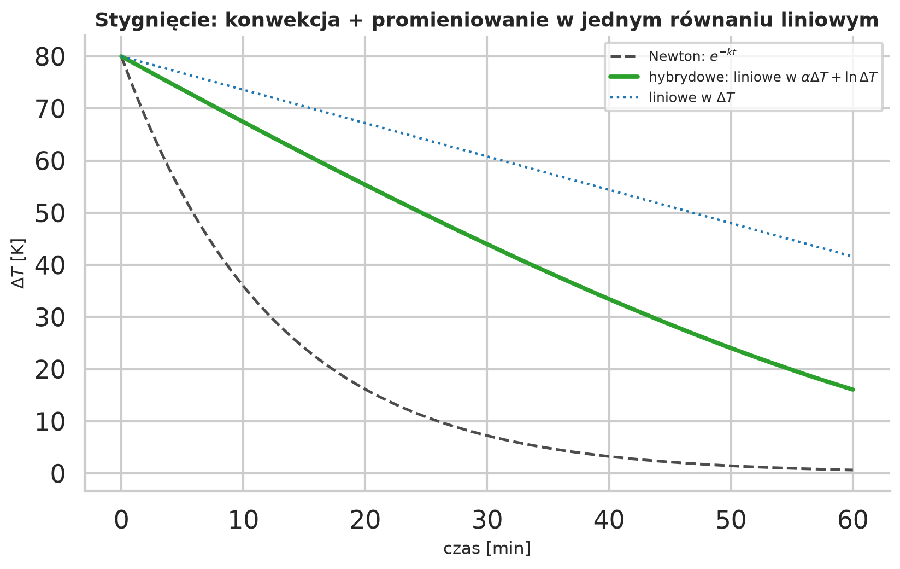
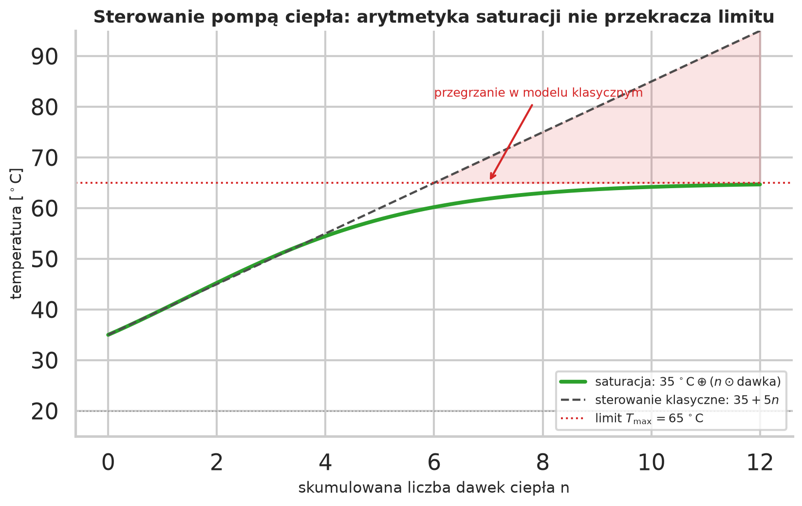

# Arytmetyki generowane funkcyjnie (rachunek nie-Newtonowski)

[](https://github.com/maciejszulia/arytmetyki-generowane-funkcyjnie/actions/workflows/ci.yml)
[](https://www.python.org/)
[](LICENSE)

Jedna bijekcja `f` przenosi strukturę ciała liczb rzeczywistych na dowolny nośnik.
Wszystko inne — zero, jedynka, dodawanie, mnożenie, potęgi, pochodna, odległość —
wynika z czterech wzorów:

```
a ⊕ b = f⁻¹(f(a) + f(b))        a ⊖ b = f⁻¹(f(a) − f(b))
n ⊙ a = f⁻¹(n · f(a))           a ⊘ n = f⁻¹(f(a) / n)
```

To jest **transport struktury** (izomorfizm ciał), spopularyzowany przez
Grossmana i Katza w 1972 r. jako *non-Newtonian calculus*. Repozytorium zawiera
dziewięć konkretnych modeli, ich jawne wzory, wizualizacje i zastosowania —
oraz uczciwą listę tego, co w tym jest stare, a co nowe.

## Dlaczego to działa

`f` to zmiana współrzędnych na osi liczbowej. W nowych współrzędnych dodawanie
jest zwykłym dodawaniem, więc każdy model jest „liniowy” — tylko linie proste
wyglądają w starych współrzędnych różnie. Dlatego:

* **nie powstają nowe twierdzenia** — wszystkie modele są izomorficzne z ℝ
  (albo z jego podzbiorem), więc algebra jest ta sama;
* powstają **nowe narzędzia**: linearyzacja zjawisk nieliniowych, naturalne
  bariery („nic nie przekroczy `c`”), stabilność numeryczna i wspólny język
  dla wzorów, które w klasycznej arytmetyce wyglądają na niepowiązane.

## Modele

| model | `f(x)` | `f⁻¹(y)` | `0_f` | `1_f` | `a ⊕ b` | `a ⊗ b` | nośnik |
|---|---|---|---|---|---|---|---|
| klasyczna | `x` | `y` | `0` | `1` | `a+b` | `ab` | ℝ |
| geometryczna | `ln x` | `e^y` | `1` | `e` | `ab` | `a^{ln b}` | `x>0` |
| harmoniczna | `1/x` | `1/y` | — (∞) | `1` | `ab/(a+b)` | `ab` | `x≠0` |
| potęgowa `p` | `x^p` | `y^{1/p}` | `0` | `1` | `(a^p+b^p)^{1/p}` | `ab` | `x≥0` |
| relatywistyczna | `artanh(v/c)` | `c·tanh y` | `0` | `c·tanh 1` | `(a+b)/(1+ab/c²)` | `c·tanh(artanh(a/c)·artanh(b/c))` | `|v|<c` |
| logistyczna | `ln(x/(1−x))` | `σ(y)` | `0,5` | `e/(e+1)` | `ab/(ab+(1−a)(1−b))` | `1/(1+((1−a)/a)^{ln((1−b)/b)})` | `0<x<1` |
| Lamberta | `x+ln x` | `W(e^y)` | `W(1)≈0,5671` | `1` | `W(ab·e^{a+b})` | `W((a·e^a)^{b+ln b})` | `x>0` |
| softplus | `ln(e^x−1)` | `ln(e^y+1)` | `ln 2` | `ln(e+1)` | `ln((e^a−1)(e^b−1)+1)` | `ln((e^a−1)^{ln(e^b−1)}+1)` | `x>0` |
| Keplera | `x+k·sin x` | numerycznie | `0` | `f⁻¹(1)` | `f⁻¹(f(a)+f(b))` | `f⁻¹(f(a)·f(b))` | ℝ |

`σ` to sigmoida, `W` — gałąź główna funkcji W Lamberta.
W kodzie **nie ma** tych uproszczonych wzorów: każdy model definiuje tylko parę
`(f, f⁻¹)`, a działania są dziedziczone z klasy bazowej. Tabela jest testowana
osobno (`tests/test_axioms.py`) — dzięki temu dokumentacja nie może rozjechać się
z implementacją.

### Trzy modele warte uwagi

**Lamberta** (`x + ln x`) — płynne przejście między światem mnożenia i dodawania:
dla małych argumentów `a ⊕ b ≈ (a·e^a)·b`, dla dużych `a ⊕ b ≈ a + b`. Nowym
zerem jest stała Omega `W(1) ≈ 0,5671`.

**Softplus** (`ln(e^x − 1)`) — to samo przejście, ale odwrócone i gładkie przy
zerze; dokładnie ta funkcja jest w ML funkcją aktywacji i podstawą `LogSumExp`.

**Keplera** (`x + k·sin x`) — oś liczbowa z okresowymi „węzłami”; ruch jednostajny
w tej osi wygląda jak skoki i spowolnienia w zwykłych współrzędnych.

## Co jest znane, a co nowe

| konstrukcja | status |
|---|---|
| cztery wzory bazowe, nowe zero/jedynka, pochodna i całka | **znane** — Grossman & Katz, *Non-Newtonian Calculus* (1972); w algebrze: izomorfizm ciał |
| `f = ln x`, `f = 1/x`, `f = x^p` | **znane** — Napier (1614), opór równoległy, p-normy Minkowskiego |
| `f = artanh(v/c)` | **znane** — Einstein (1905), składanie prędkości |
| `f = ln(x/(1−x))` | **znane** — log-odds, twierdzenie Bayesa, t-konorma Hamachera w logice rozmytej |
| `f = ln(e^x−1)`, softplus | **znane** — funkcja aktywacji, `LogSumExp`, równanie diody Shockleya |
| `f = x + ln x` jako generator pełnej arytmetyki | **oryginalne** — brak takiego zestawienia w literaturze |
| `f = x + k·sin x` jako generator arytmetyki | **oryginalne** — samo równanie Keplera jest z 1609 r., arytmetyka na nim nie |
| złożenia 2. rzędu (`logit³`, `T⁴`, saturacja) | **oryginalne jako systemy**, ale każdy to nadal izomorfizm |

## Wykresy



Generator `f` i jego pochodna: tam, gdzie `f'` rośnie, liczby w nowej osi się
ściskają; tam, gdzie maleje — rozciągają.



To samo działanie `0,8 ⊕ x` w siedmiu światach. Model logistyczny nigdy nie
opuszcza `(0,1)`, a `0_f = 0,5` jest jego elementem neutralnym.



Mapy cieplne `z = x ⊕ y`. Klasyczna jest płaska, geometryczna to hiperbola,
logistyczna ma „przekątną” `x ⊕ y = 0,5` (gdy `y = 1−x`), relatywistyczna
nasyca się na brzegach.



Model Lamberta: dla `x ≪ 1` wynik zgadza się z mnożeniem przez `a·e^a`, dla
`x ≫ 1` — z dodawaniem `a + x`. Błąd względny wobec każdej z asymptot spada
po swojej stronie wykresu.



Ruch jednostajny w osi Keplera (`k = 0,5` i `k = 0,85`) i jego prędkość:
spowolnienia wypadają w węzłach `x = (2n+1)π`.



Dwa źródła po 300 K dają `300·2^{1/4} ≈ 356,7 K`, a nie 600 K — bo dodają się
strumienie `σT⁴`, nie temperatury.



Stygnięcie konwekcją i promieniowaniem: w zmiennej `αΔT + ln ΔT` proces jest
liniowy, w `ΔT` — nie.



Sterowanie pompą ciepła: arytmetyka saturacji sama pilnuje limitu `T_max`,
podczas gdy sterowanie klasyczne przegrzewa układ.

## Zastosowania (z liczbami)

| dziedzina | model | konkret |
|---|---|---|
| szczególna teoria względności | relatywistyczna | `0,6c ⊕ 0,7c = 0,9155c`, nigdy nie przekroczy `c` |
| elektrotechnika | harmoniczna | `2 Ω ⊕ 3 Ω = 1,2 Ω` — opór równoległy |
| akustyka | geometryczna | `80 dB ⊕ 80 dB = 83,0 dB` (dwa jednakowe źródła) |
| wymiana ciepła | potęgowa `p=4` | `300 K ⊕ 300 K = 356,7 K` — prawo Stefana–Boltzmanna |
| statystyka, ML | logistyczna | `0,8 ⊕ 0,6 = 0,857` — łączenie szans, twierdzenie Bayesa |
| ML, stabilność numeryczna | softplus | `LogSumExp` zamiast `ln(e^a+e^b)` bez przepełnień |
| elektronika nieliniowa | softplus / Lamberta | równanie diody `I = I_s(e^{V/V_T}−1)` odwracane funkcją `W` |
| mechanika nieba | Keplera | równanie Keplera `M = E − e·sin E` |
| uczenie maszynowe | potęgowa `p` | metryki Minkowskiego, `p`-normy w embeddingach |
| sterowanie, HVAC | saturacja | regulator bez przegrzania: `T(n) → T_max` asymptotycznie |

## Ograniczenia i pułapki numeryczne

* **Nie każdy model jest ciałem.** Harmoniczna nie ma zera (`0_f = ∞`), potęgowa
  i radiacyjna nie mają liczb przeciwnych (nośnik `[0,∞)`). Testy sprawdzają to
  jawnie, zamiast udawać, że aksjomaty zachodzą wszędzie.
* **`W(e^y)` przepełnia** dla `y > 709`. Dlatego `f⁻¹` w modelu Lamberta rozwiązuje
  `w + ln w = y` metodą Newtona — bez wykładniczej eksplozji, do `y ≈ 10^{12}`.
* **Złe uwarunkowanie przy `0_f`.** W modelu `logit³` pochodna `f'(0,5) = 0`, więc
  błąd `10^{-16}` w `f` daje `10^{-5}` w `x`. To własność modelu, nie bug; dlatego
  test toleruje tam `10^{-4}`.
* **Nasycenie `float`.** `tanh(10^6·artanh 0,5)` to w `float64` dokładnie `1,0`;
  teoria mówi „< c”, IEEE 754 mówi „= c”.
* **Koszt.** `f⁻¹` dla Keplera, Lamberta i saturacji wymaga iteracji (4–8 kroków
  Newtona); dla `10^6` punktów to zauważalnie wolniej niż dodawanie.

## Instalacja i użycie

```bash
python -m venv .venv && . .venv/bin/activate
pip install -e ".[dev]"

pytest -v                 # 23 testy: aksjomaty ciała + zgodność wzorów
python -m nna.figures     # wykresy do docs/figures/
```

```python
from nna import Lambert, Relativistic, ThermalSaturation

m = Lambert()
m.add(0.4, 1.5)        # 1.2037  — W(0,6·e^{1,9})
m.zero()               # 0.5671  — stała Omega
m.mul(2.0, 3.0)        # pełne mnożenie w nowym ciele

v = Relativistic(c=299_792_458.0)
v.add(0.6 * v.c, 0.7 * v.c) / v.c   # 0.9155 — składanie prędkości

h = ThermalSaturation(20.0, 65.0)
h.add(60.0, 60.0)      # < 65 — saturacja trzyma limit
```

## Struktura

```
src/nna/core.py        # klasa bazowa + 8 modeli (tylko pary f, f⁻¹)
src/nna/thermal.py     # promieniowanie, chłodzenie hybrydowe, saturacja
src/nna/figures.py     # 8 wykresów: matplotlib + seaborn
tests/test_axioms.py   # aksjomaty + jawne wzory + przypadki brzegowe
docs/paper.tex         # artykuł (PL) z wyprowadzeniami i tabelą
matlab/nna_demo.m      # wersja MATLAB/Octave: modele + wykresy
```

## Literatura

* M. Grossman, R. Katz, *Non-Newtonian Calculus*, Lee Press, 1972.
* A. Einstein, *Zur Elektrodynamik bewegter Körper*, Annalen der Physik 17 (1905).
* A. Kołmogorow, *Sur la notion de la moyenne*, Atti Accad. Naz. Lincei 12 (1930);
  M. Nagumo, *Über eine Klasse von Mittelbildungen*, Japanese J. Math. 7 (1930).
* R. Corless, G. Gonnet, D. Hare, D. Jeffrey, D. Knuth, *On the Lambert W function*,
  Adv. Comput. Math. 5 (1996).
* C. Tsallis, *Possible generalization of Boltzmann–Gibbs statistics*,
  J. Stat. Phys. 52 (1988) — q-arytmetyka jako pokrewny przypadek.
* J. Kepler, *Astronomia nova*, 1609 — równanie `M = E − e·sin E`.

## Licencja

MIT — patrz [LICENSE](LICENSE).
