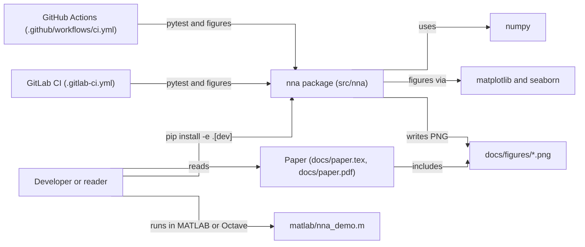
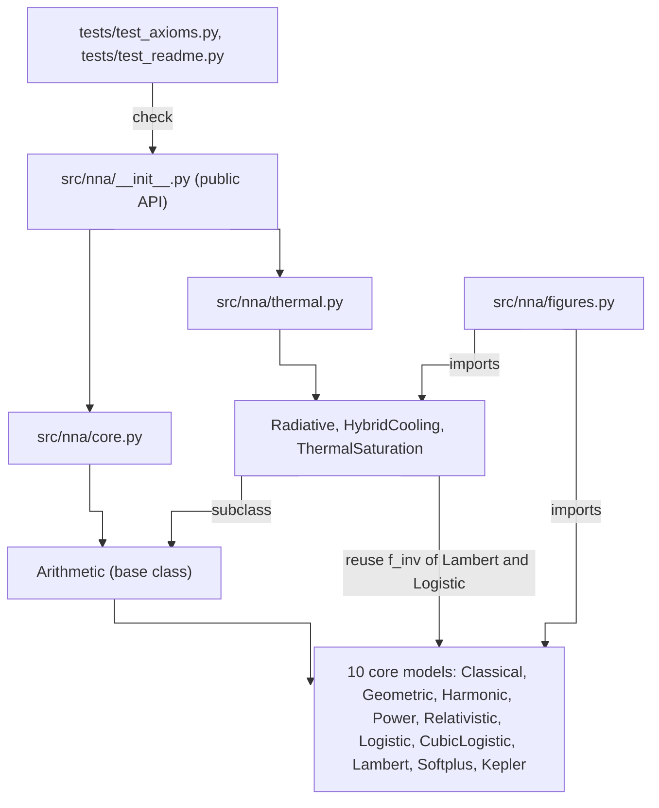
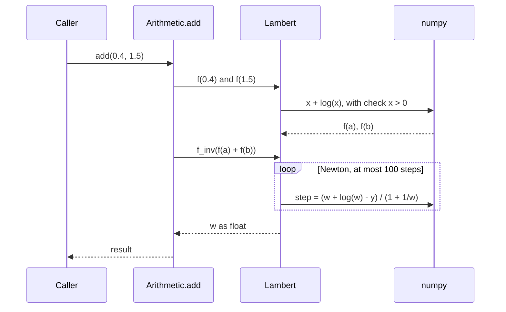

# Architecture: nna (function-generated arithmetics)

This document describes the architecture of the `nna` Python package and its
supporting files, following the arc42 template. The project README
([../../README.md](../../README.md), in Polish) describes the mathematics; this
document describes how the repository is built.

## 1. Introduction and goals

`nna` implements arithmetics generated by one bijection `f`. Every operation is
transported from the real numbers:

```
a ⊕ b = f⁻¹(f(a) + f(b))        a ⊖ b = f⁻¹(f(a) − f(b))
n ⊙ a = f⁻¹(n · f(a))           a ⊘ n = f⁻¹(f(a) / n)
```

The repository delivers:

- a Python package (`src/nna/`) with 10 core models and 3 thermal models;
- a test suite that checks the field axioms and the closed-form formulas of the README;
- a figure generator that writes 8 PNG figures to `docs/figures/`;
- a paper in Polish (`docs/paper.tex`, `docs/paper.pdf`);
- a MATLAB/Octave demo (`matlab/nna_demo.m`).

Quality goals, in priority order:

| Priority | Goal | How the repository meets it |
|---|---|---|
| 1 | Correctness of the transported operations | Operations are written once in the base class; tests check the axioms per model. |
| 2 | Documentation matches code | `tests/test_readme.py` fails when the README model table and the model classes differ in count. |
| 3 | Numerical robustness | Inverses without a closed form use Newton iteration with a convergence test. |

## 2. Constraints

| Constraint | Source |
|---|---|
| Python 3.10 or newer | `pyproject.toml` (`requires-python = ">=3.10"`) |
| Runtime dependency: `numpy>=1.24` only | `pyproject.toml` (`dependencies`) |
| Development extras: `scipy`, `matplotlib`, `seaborn`, `pytest` | `pyproject.toml` (`[project.optional-dependencies] dev`) |
| Build backend: setuptools, `src/` layout | `pyproject.toml` (`[build-system]`, `[tool.setuptools.packages.find]`) |
| Licence: MIT | `LICENSE`, `pyproject.toml` |

## 3. Context and scope

The package is a library. A developer installs it, imports models, and calls
their methods. Two CI services run the tests and build the figures. The paper and
the MATLAB demo are separate artefacts that share the formulas but not the code.



Out of scope: a command-line calculator, a web interface, and a published PyPI
release. No file in the repository provides them.

## 4. Solution strategy

- **One base class, many generators.** `Arithmetic` in `src/nna/core.py` defines
  all operations (`add`, `sub`, `scale`, `unscale`, `mul`, `div`, `neg`, `zero`,
  `one`, `power`, `root`, `mean`, `distance`) in terms of `f` and `f_inv`. A model
  subclass defines only `f` and `f_inv`. See [ADR 0001](adr/0001-models-define-only-generator-pair.md).
- **Numerical inverses where no closed form exists.** `Lambert` and `Kepler`
  solve `f(x) = y` by Newton iteration. See [ADR 0002](adr/0002-newton-inverse-for-lambert.md).
- **Tests guard the documentation.** The README table is tied to the model classes
  by a test. See [ADR 0003](adr/0003-readme-table-tied-to-code-by-test.md).
- **Two CI services with the same jobs.** See [ADR 0004](adr/0004-ci-on-github-and-gitlab.md).

## 5. Building block view



| Building block | Responsibility | File |
|---|---|---|
| `Arithmetic` | Transported field operations from `f` and `f_inv`; helper `_num` turns 0-d arrays into `float` | `src/nna/core.py` |
| Core models | One generator pair each; domain checks raise `ValueError` | `src/nna/core.py` |
| Thermal models | Radiation (`T⁴`), hybrid cooling (`αΔT + ln ΔT`), saturation between `T_min` and `T_max` | `src/nna/thermal.py` |
| Figure generator | 8 functions `fig_*`, entry point `main()`, output directory `docs/figures/` | `src/nna/figures.py` |
| Axiom tests | Field axioms per model, closed-form formulas, edge cases; reference values from `scipy` | `tests/test_axioms.py` |
| README test | Row count of the README model table equals the number of core model classes | `tests/test_readme.py` |
| MATLAB demo | Independent re-implementation of selected models and plots | `matlab/nna_demo.m` |

`HybridCooling.f_inv` calls `Lambert().f_inv`, and `ThermalSaturation.f_inv` calls
`Logistic().f_inv` (`src/nna/thermal.py`).

## 6. Runtime view

Main flow: a caller adds two numbers in the Lambert arithmetic.



Second flow: `python -m nna.figures` (or the `nna-figures` script from
`pyproject.toml`) calls `_style()`, then the 8 `fig_*` functions in order. Each
function saves one PNG through `_save()`, which creates `docs/figures/` when it
is missing.

## 7. Deployment view

The package runs locally from an editable install:

```bash
python -m venv .venv && . .venv/bin/activate
pip install -e ".[dev]"
pytest -v
python -m nna.figures
```

CI runs the same steps:

| Service | File | Jobs | Artefact |
|---|---|---|---|
| GitHub Actions | `.github/workflows/ci.yml` | 1 job `test` on `ubuntu-latest`, Python 3.12: install, `pytest -v`, `python -m nna.figures` | `figures` (`docs/figures/*.png`) |
| GitLab CI | `.gitlab-ci.yml` | stage `test` (`pytest -v`), stage `build` (`python -m nna.figures`), image `python:3.12-slim` | `docs/figures/`, kept 1 week |

GitHub Actions runs on push to `main` and on pull requests to `main`. Neither CI
builds `docs/paper.pdf`; the PDF is committed.

## 8. Crosscutting concepts

- **Domain validation.** Each model checks its carrier in `f` and raises
  `ValueError` with a message in Polish (for example `Lambert.f` requires `x > 0`,
  `Kepler.__init__` requires `0 < k < 1`).
- **Vectorisation.** Methods accept scalars and `numpy` arrays; `_num()` returns a
  `float` for scalar input.
- **Convergence test.** Newton loops stop when every step is at most
  `1e-15 · max(1, |x|)` or after 100 iterations.
- **Metadata per model.** Each model carries `name`, `generator`, `inverse` and
  `domain` strings (LaTeX for the formulas), used for labels in figures.
- **Language.** Identifiers are English; docstrings, error messages and the
  README are Polish.

## 9. Architecture decisions

- [ADR 0001: Models define only the generator pair (f, f⁻¹)](adr/0001-models-define-only-generator-pair.md)
- [ADR 0002: Newton iteration for the Lambert inverse instead of W(eʸ)](adr/0002-newton-inverse-for-lambert.md)
- [ADR 0003: README model table tied to the code by a test](adr/0003-readme-table-tied-to-code-by-test.md)
- [ADR 0004: The same CI jobs on GitHub Actions and GitLab CI](adr/0004-ci-on-github-and-gitlab.md)

## 10. Quality requirements

| Scenario | Measure | Check |
|---|---|---|
| A developer adds a model class to `core.py` without a README row | Test fails | `tests/test_readme.py::test_readme_lists_every_core_model` |
| A model violates associativity, neutral element or inverse | Test fails within the tolerance of the model | `tests/test_axioms.py` (parametrised over `FIELDS`) |
| A Lambert inverse is requested for a large argument | No overflow; result from Newton iteration | `Lambert.f_inv` in `src/nna/core.py` |
| A change breaks figure generation | CI job fails | `python -m nna.figures` step in both CI files |

## 11. Risks and technical debt

- **Ill-conditioning near `0_f`.** In `CubicLogistic`, `f'(0.5) = 0`; the README
  states that the test tolerance there is `10^{-4}`.
- **Iteration cost.** `f_inv` of `Lambert`, `Kepler` and `HybridCooling` loops in
  Python over Newton steps; large arrays take noticeably longer than closed-form
  models (README, section on numerical pitfalls).
- **Output path depends on the source tree.** `figures.OUT` is computed from
  `__file__` as `<repository root>/docs/figures`, so a non-editable install writes figures
  outside a source checkout.
- **Duplicate implementation.** `matlab/nna_demo.m` re-implements the models; no
  test compares it with the Python code.
- **Duplicate dependency lists.** `requirements.txt` and `pyproject.toml` both list
  dependencies; CI uses only `pyproject.toml`.

### Open questions

- The README states "23 testy" for `pytest -v`. The test files contain 16 test
  functions, some parametrised; the total was not counted by running the suite.

## 12. Glossary

| Term | Meaning |
|---|---|
| Generator `f` | Bijection from a carrier set onto (a subset of) the real numbers |
| Carrier | Domain on which `f` is a bijection (column "nośnik" in the README) |
| `0_f`, `1_f` | Transported neutral elements, `f⁻¹(0)` and `f⁻¹(1)` |
| Transport of structure | Defining operations on the carrier by mapping through `f` and back |
| Kolmogorov mean | `f⁻¹(mean(f(xᵢ)))`, method `Arithmetic.mean` |
| Omega constant | `W(1) ≈ 0.5671`, the zero of the Lambert arithmetic |
